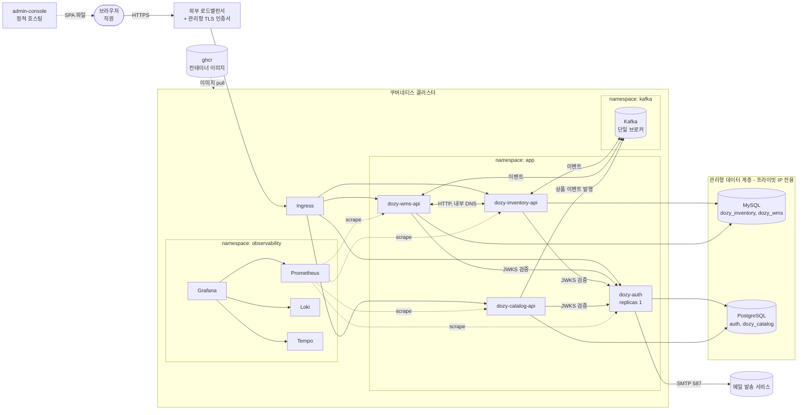
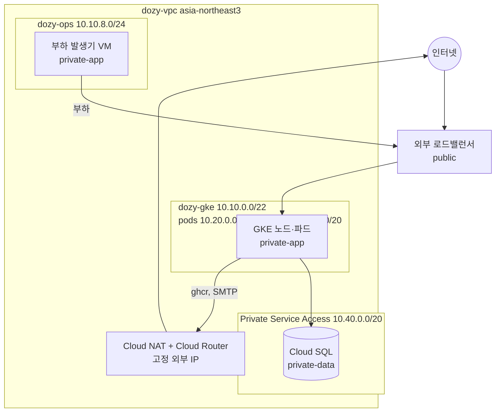

# Dozy 시스템 아키텍처 (초안)

> 상태: 초안. 구현 전 설계 정리이며, 확인되지 않은 항목은 [미결정·확인 필요](#13-미결정확인-필요-항목)에 모았다.
> 작성일: 2026-10-14

## 1. 목적과 전제

- 이 프로젝트는 MSA와 백엔드 운영을 **학습**하기 위한 것이며 실사용자가 없다.
- 그래서 **환경은 하나**로 시작한다. dev와 prod를 나누지 않되 운영하듯 다룬다(태그 릴리스, Helm values, Secret). 팀원마다 자기 GCP 프로젝트에 같은 코드를 올린다([infra-repo-design.md](infra-repo-design.md)).
- 1차 대상 클라우드는 **GCP**(리전 `asia-northeast3`, 서울)이다. 설계는 클라우드 중립 용어로 쓰고 [GCP ↔ AWS 대응표](#12-gcp--aws-대응표)를 둔다. 나중에 AWS로 옮겨도 같은 구조로 다시 만들 수 있게 한다.
- 인프라는 테라폼으로 만들고 앱은 공통 Helm 차트로 배포한다.
- 학습 목적상 관측 도구(Prometheus, Grafana, Loki, Tempo)는 관리형이 아니라 클러스터에 직접 설치한다.

## 2. 서비스 인벤토리

| 서비스 | 종류 | 스택 | 저장소 | 포트 | 상태/확장 |
|---|---|---|---|---|---|
| dozy-auth | 백엔드 | Kotlin, Spring MVC | PostgreSQL | 8080 | **replicas 1 고정** (인메모리 요청 제한과 `@Scheduled`, ADR-0024) |
| dozy-inventory-api | 백엔드 | Kotlin, WebFlux, R2DBC | MySQL `dozy_inventory` | 8082 | 다중 인스턴스 안전 (ADR 기준) |
| dozy-wms-api | 백엔드 | Kotlin, WebFlux, R2DBC | MySQL `dozy_wms` | 8080 | 스케줄러 안전성 **확인 필요**, actuator **없음** |
| dozy-catalog-api | 백엔드 | Kotlin, WebFlux, R2DBC | PostgreSQL | 8080 | 다중 인스턴스 안전(스케줄러는 예약마다 잠금). 릴리스 전이라 `sha-` 태그. Store 분리 작업 진행 중 |
| dozy-admin-console | SPA | React 19, Vite | 없음 | – | 정적 호스팅 |
| dozycoffee.github.io | 기술 블로그 | Astro | 없음 | – | GitHub Pages. 이 아키텍처의 범위 밖 |

예정(지금은 자리만 남긴다): Store(저장소는 있으나 이미지 없음). 그 밖의 서비스는 필요할 때 추가한다.

### 서비스 간 의존

| 방향 | 방식 | 내용 |
|---|---|---|
| 브라우저 → auth, wms, inventory | HTTPS (직접 호출) | 로그인과 업무 API. CORS 설정 필요, auth는 refresh 쿠키 사용 |
| wms, inventory → auth | HTTP | JWKS로 JWT 검증 (`AUTH_ISSUER_BASE_URI`) |
| inventory → wms | Kafka | `dozy.inventory.{product,reservation,lot}` |
| wms → inventory | Kafka | `dozy.wms.warehouse-access` |
| wms → inventory | HTTP | 호출 아웃박스 (`INVENTORY_BASE_URL`), system client 토큰 |
| inventory → wms | HTTP | 정합성 대사 배치 (`WMS_BASE_URL`), system client 토큰 |
| catalog → auth | HTTP | JWKS로 JWT 검증 (`DOZY_AUTH_ISSUER_BASE_URI`), system client 토큰(`svc-catalog`) |
| catalog → Kafka | Kafka | `dozy.catalog.product` 발행(아웃박스). 구독자는 Store(예정, 그룹 `store.product-replica`) |
| catalog → store | HTTP | 판매 범위의 대상 매장 확인 (`STORE_BASE_URL`). Store가 없으면 해당 요청만 503 |
| auth → 메일 서버 | SMTP (587, STARTTLS) | 초대와 이메일 인증 |

## 3. 논리 아키텍처



설계 원칙:

1. 외부에서 보이는 것은 **로드밸런서 하나**뿐이다. 서비스, DB, Kafka, 관측 도구는 모두 프라이빗이다.
2. 서비스 사이의 호출은 클러스터 안에서 **내부 DNS**(`<서비스>.<namespace>.svc`)로 한다.
3. 비밀값과 환경별 값은 이미지가 아니라 환경변수(ConfigMap, Secret)로 주입한다.
4. 한 번 빌드한 이미지(`sha-` → `vX.Y.Z`)를 그대로 배포한다.

## 4. 네트워크 설계

### 4.1 GCP와 AWS의 구조 차이

| | GCP | AWS |
|---|---|---|
| VPC 범위 | 전역 | 리전 |
| 서브넷 범위 | **리전** (여러 존에 걸침) | **가용 영역(AZ)** |
| 퍼블릭/프라이빗 서브넷 | 구분 없음. 외부 IP 유무와 라우팅으로 결정 | 서브넷 종류가 따로 있음 |
| 외부로 나가는 통신 | Cloud NAT | NAT Gateway |

이 문서는 용어를 **3계층**(public, private-app, private-data)으로 통일한다. GCP에서는 서브넷이 아니라 "외부 IP를 갖는지"로 구분되고, AWS에서는 계층마다 서브넷을 AZ별로 만든다.

### 4.2 계층

| 계층 | 들어 있는 것 | 외부 IP | 인터넷에서 직접 접근 |
|---|---|---|---|
| public | 로드밸런서, NAT 외부 IP | 있음 | 가능 (로드밸런서만) |
| private-app | 쿠버네티스 노드와 파드, 부하 발생기 VM | 없음 | 불가 |
| private-data | Cloud SQL (MySQL, PostgreSQL) | 없음 (프라이빗 IP) | 불가 |

### 4.3 VPC와 서브넷 (GCP 기준 제안)

- VPC: `dozy-vpc`, **custom 모드** (default VPC는 쓰지 않는다).
- 리전: `asia-northeast3` 하나.
- 사설 대역은 `10.0.0.0/8` 안에서 겹치지 않게 나눈다. 나중에 AWS VPC나 사내망과 연결(피어링)할 가능성을 고려해 서로 다른 대역을 쓴다.

| 이름 | 용도 | 대역 | 비고 |
|---|---|---|---|
| `dozy-gke` (primary) | 클러스터 노드 | `10.10.0.0/22` | Private Google Access 켬 |
| `dozy-gke` secondary `pods` | 파드 IP | `10.20.0.0/16` | 서브넷의 보조 대역 |
| `dozy-gke` secondary `services` | 클러스터 서비스 IP | `10.30.0.0/20` | 서브넷의 보조 대역 |
| `dozy-ops` | 부하 발생기 VM, 점검용 VM | `10.10.8.0/24` | 외부 IP 없음. 접속은 IAP |
| Private Service Access 예약 대역 | Cloud SQL | `10.40.0.0/20` | VPC 피어링으로 구글 관리 네트워크와 연결 |
| `dozy-proxy-only` (선택) | 리전 단위 로드밸런서의 프록시 | `10.10.16.0/23` | 리전 로드밸런서를 쓸 때만 필요 |



### 4.4 외부로 나가는 통신 (egress)

프라이빗 노드는 외부 IP가 없어서 **Cloud NAT**가 없으면 아래가 막힌다.

- **ghcr.io 이미지 pull**: 없으면 파드가 `ImagePullBackOff`가 된다.
- **SMTP**: auth가 메일을 보낼 때 (587).
- 구글 API(Secret Manager, 로깅 등)는 서브넷의 **Private Google Access**로 NAT 없이 간다.

### 4.5 방화벽 (기본: 수신 거부, 송신 허용)

| 규칙 | 방향 | 허용 |
|---|---|---|
| 로드밸런서 헬스 체크 | ingress | 구글 헬스 체크 대역 → 노드의 서비스 포트 |
| 파드 ↔ 파드 | ingress | 클러스터 내부 통신 (GKE가 자동 생성하는 규칙) |
| 점검용 접속 | ingress | IAP 대역 → `dozy-ops` (22) |
| DB 접속 | – | 방화벽이 아니라 Private Service Access와 DB 권한으로 제한 |
| 그 외 | ingress | 거부 |

쿠버네티스 안쪽의 세부 통제는 **NetworkPolicy**로 한다. 예: DB 접속 허용 서비스 제한, 관리 포트에는 Prometheus 파드만 접근.

### 4.6 외부 노출 경로

| 도메인(예시) | 대상 | 비고 |
|---|---|---|
| `admin.<도메인>` | admin-console | 정적 호스팅. 도메인은 팀원별 서브도메인 `<이름>.dozy.kr` 아래에 둔다 |
| `auth.<도메인>` | dozy-auth | refresh 쿠키 때문에 콘솔과 같은 사이트(eTLD+1) 아래 두는 것이 안전 |
| `wms.<도메인>` | dozy-wms-api | 업무 API만 노출 |
| `inventory.<도메인>` | dozy-inventory-api | 업무 API만 노출 |
| `catalog.<도메인>` | dozy-catalog-api | 업무 API만 노출. 관리 콘솔이 브라우저에서 직접 호출하므로 CORS 설정 필요 |

- 경로 기반 라우팅(단일 도메인에 `/auth`, `/wms`, `/inventory`, `/catalog`)과 도메인 분리 중 무엇을 쓸지는 [미결정](#13-미결정확인-필요-항목)이다.
- **`/actuator/*`는 Ingress에서 노출하지 않는다.** 아래 관리 포트 분리를 표준으로 한다.

### 4.7 관리 포트 분리 (표준)

모든 백엔드는 `management.server.port`를 업무 포트와 **다른 포트**로 둔다. Service와 Ingress에는 업무 포트만 연결하고, 관리 포트는 Prometheus의 scrape와 쿠버네티스 probe 전용으로 쓴다. NetworkPolicy로 관리 포트 접근을 Prometheus 파드와 kubelet으로 제한한다.

## 5. 컴퓨트 (쿠버네티스)

| 항목 | 제안 | 이유 |
|---|---|---|
| 종류 | GKE **Autopilot**, 프라이빗 노드 | 노드 관리 부담이 없고 파드 단위 과금 |
| 컨트롤 플레인 엔드포인트 | 승인된 네트워크(내 IP)에서만 접근 | 외부 전체에 열지 않는다 |
| 네임스페이스 | `app`, `kafka`, `observability` | 권한과 NetworkPolicy 경계 |
| 이미지 | `ghcr.io/dozycoffee/<서비스>:<X.Y.Z>` (릴리스 전 서비스는 `sha-<7자리>` 고정) | private이면 `imagePullSecrets` 필요 |
| 배포 정의 | 공통 Helm 차트 `dozy-service` + 서비스별 values | 서비스 추가가 values 파일 추가로 끝난다. 자세한 구조는 [infra-repo-design.md](infra-repo-design.md) |
| 배포 | 이미지 태그 변경 → `helm upgrade` (이후 GitOps 검토) | |

### 서비스별 레플리카 시작값

| 서비스 | replicas | 배포 전략 | 비고 |
|---|---|---|---|
| auth | 1 | 롤링(`maxUnavailable: 0`, `maxSurge: 1`) | 서명 키 볼륨 마운트. 늘리려면 Redis와 ShedLock 도입이 선행 |
| inventory | 1에서 시작, 학습 중 2~3으로 확장 | 롤링 | 부하 테스트로 HPA 실습 |
| wms | 1 | 롤링 | 스케줄러 확인 후 확장. 기동 지연(Kafka)이 있어 `startupProbe` 필요 |
| catalog | 1에서 시작 | 롤링 | 다중 인스턴스 안전(예약 적용 배치는 예약마다 잠그고, 아웃박스 발행은 한 번에 한 인스턴스). 릴리스 전이라 `sha-` 태그 고정 |
| admin-console | 해당 없음 | | 정적 호스팅 |

공통: `requests`와 `limits`는 측정 후 정한다(JVM은 힙 75%). `PodDisruptionBudget`은 레플리카가 2 이상일 때 `minAvailable: 1`. HPA는 레플리카가 2 이상으로 안정된 서비스에만 적용한다.

### probe

| 서비스 | liveness / readiness | 비고 |
|---|---|---|
| auth | `/actuator/health` | 상세 헬스는 비노출 |
| inventory | `/actuator/health/liveness`, `/actuator/health/readiness` | readiness는 DB만 확인 |
| wms | **없음** | actuator 추가 후 적용 |
| catalog | `/actuator/health` (`liveness`, `readiness` 그룹도 있음) | 업무 포트와 같은 포트. `/actuator/prometheus`도 같은 포트에서 토큰 없이 열려 있어 Ingress에서 `/actuator/*`를 막아야 한다 |

## 6. 데이터 계층

| 대상 | 제안 | 비고 |
|---|---|---|
| MySQL | Cloud SQL for MySQL 8.0, 프라이빗 IP, 최소 티어, HA 끔 | 인스턴스 하나에 `dozy_inventory`, `dozy_wms` DB 두 개. 문자셋 `utf8mb4`, 시간대 `Asia/Seoul` |
| PostgreSQL | Cloud SQL for PostgreSQL, 프라이빗 IP, 최소 티어 | auth와 catalog(`dozy_catalog`)가 같은 인스턴스에 DB를 따로 쓴다. Store가 붙으면 같은 인스턴스에 추가. MySQL과 엔진이 달라 인스턴스가 별도 |
| Kafka | 클러스터 안 StatefulSet 단일 브로커(`kafka_mode=self`)로 시작하고, 이후 매니지드와 비교 | wms 토픽은 replica 1(`dozy.wms.warehouse-access`)이므로 단일 브로커와 맞음. 토픽은 `topics/topics.yaml`에 선언해 만들고 서비스는 만들지 않는다. 자세한 내용은 [infra-repo-design.md](infra-repo-design.md) |
| 백업 | Cloud SQL 자동 백업 켬, Kafka는 보관 안 함 | 학습 환경이라 Kafka 데이터는 유실 허용. 이벤트는 inventory와 catalog의 Outbox로 재발행 가능 |

- 마이그레이션은 앱 기동 시 Flyway가 적용한다. 레플리카가 2 이상이 되면 별도 Job으로 분리하는 것을 검토한다.
- 파드가 늘면 DB 커넥션이 늘어난다. wms 풀 최대 20개 × 파드 수가 `max_connections` 안에 들어야 한다.
- 접속은 모두 프라이빗 IP이며, 점검용 접속은 `dozy-ops` VM(IAP)이나 Cloud SQL Auth Proxy로 한다.

## 7. 비밀값과 설정

| 값 | 보관 | 주입 |
|---|---|---|
| DB 비밀번호, system client secret, SMTP 자격 | Secret Manager | External Secrets Operator 또는 CSI 드라이버로 쿠버네티스 Secret 생성 |
| auth 서명 키(RSA PEM) | Secret Manager | 볼륨으로 마운트 (읽기 전용, UID 10001이 읽을 수 있어야 함) |
| 일반 설정(주소, 포트, CORS origin) | 매니페스트의 ConfigMap | 환경변수 |

- 워크로드가 클라우드 API(Secret Manager 등)에 접근할 때는 키 파일 대신 **Workload Identity**를 쓴다.
- 비밀값은 이미지, 매니페스트 저장소, 로그에 넣지 않는다.

## 8. 관측

```
서비스 (관리 포트 /actuator/prometheus) ◄── Prometheus ──► Grafana
서비스 stdout 로그 ──► (수집 에이전트) ──► Loki ──► Grafana
서비스 트레이스(traceparent) ──► Tempo ──► Grafana
```

- 설치: `kube-prometheus-stack`(Prometheus, Grafana, 알림), Loki, Tempo를 `observability` 네임스페이스에 둔다.
- Grafana 접근: 처음엔 `kubectl port-forward`, 이후 IAP나 OAuth 로그인.
- 기술 메트릭은 Grafana, 업무 지표는 admin-console의 몫이다.
- 선행 작업: wms에 actuator와 Micrometer 추가, inventory의 prometheus 노출 확인.
- 알림 기준 예시: 파드 재시작, 에러율, p99 지연, Kafka consumer lag, Outbox 대기 건수.

## 9. CI/CD

```
PR → CI(빌드·테스트·이미지 스모크) → main 병합 → sha-<7자리> 이미지 push (multi-arch)
   → vX.Y.Z 태그 push → release.yml이 같은 이미지에 X.Y.Z 태그와 GitHub Release
   → 매니페스트의 이미지 태그를 올려 배포
```

- 레지스트리는 현재 ghcr. 비용이나 pull 속도가 문제가 되면 Artifact Registry로 옮긴다(이미지 이름만 바뀐다).
- **admin-console**은 아직 배포 방식이 없다. API 주소(`VITE_*`)가 빌드 시점에 박히므로, 런타임에 읽는 설정 파일(`config.json`) 방식으로 바꿔 "한 번 빌드, 어디서나 배포"를 지키는 것을 권한다.

## 10. 부하 테스트와 비용 통제

### 부하 발생기 위치

| 목적 | 위치 |
|---|---|
| 서버 용량, 병목, 오토스케일 | 같은 리전의 `dozy-ops` VM (외부 IP 없음, 로드밸런서 주소로 호출) |
| 체감 응답 시간 | 로컬 PC에서 소량 |

같은 리전의 부하는 네트워크 지연이 거의 없어서 사용자 체감 성능을 대표하지 않는다. 용량 측정과 체감 측정을 구분한다. 앞단(Ingress부터)을 포함해서 걸어야 로드밸런서 설정의 영향이 반영된다.

### 비용 통제

- **예산 알림을 가장 먼저** 설정한다. 가능하면 임계치 도달 시 자동으로 줄이는 장치를 둔다.
- 사용하지 않는 시간에는 파드 0개, Cloud SQL 중지. 테라폼 `apply`와 `destroy`로 켜고 끈다.
- HPA의 **최대 파드 수 상한**을 낮게 둔다.
- 부하 중에는 로그 레벨을 올리고(INFO, WARN), 불필요한 로그는 수집 제외 필터로 버린다.
- 상시 비용이 큰 항목: Cloud SQL 두 개, Cloud NAT, 로드밸런서, 관측 스택의 디스크. 금액은 GCP 가격 계산기로 확인한다.
- 부하 후 테스트 데이터를 초기화하는 절차를 둔다(wms는 배포 전까지 Flyway 3개 파일을 직접 고치고 DB를 리셋하는 규칙이 있다).

## 11. 인프라 코드 구조 (테라폼)

```
dozy-infra/
├─ terraform/
│  ├─ modules/       network, gke, cloudsql, iam, secrets, kafka-managed
│  └─ stacks/gcp/    위 모듈 호출 (상태 파일은 각자의 GCS 버킷)
├─ charts/           dozy-service(공통), kafka-self
├─ releases/         서비스별 values, 배포 순서
└─ topics/           Kafka 토픽 선언
```

- 클라우드가 바뀌면 `modules/`만 새로 쓰고 `charts/`, `releases/`는 거의 그대로 쓴다.
- 이 저장소는 별도 저장소(`dozy-infra`)로 둔다. 서비스 코드와 배포 변경 이력이 분리된다.

## 12. GCP ↔ AWS 대응표

| 영역 | GCP | AWS |
|---|---|---|
| 네트워크 | VPC (전역), 리전 서브넷 | VPC (리전), AZ별 서브넷 |
| 외부 송신 | Cloud NAT + Cloud Router | NAT Gateway |
| 클라우드 API 사설 접근 | Private Google Access | VPC Endpoint (Gateway/Interface) |
| 관리형 DB 사설 연결 | Private Service Access (VPC 피어링) | DB Subnet Group (VPC 안에 생성) |
| 쿠버네티스 | GKE Autopilot | EKS (Fargate 또는 Karpenter/관리형 노드 그룹) |
| 로드밸런서 | Cloud Load Balancing (GKE Ingress/Gateway) | ALB (AWS Load Balancer Controller) |
| TLS 인증서 | Google-managed certificate | ACM |
| DNS | Cloud DNS | Route 53 |
| MySQL / PostgreSQL | Cloud SQL | RDS (또는 Aurora) |
| Kafka (관리형 선택 시) | Managed Service for Apache Kafka / Confluent | MSK |
| 비밀값 | Secret Manager | Secrets Manager |
| 워크로드 인증 | Workload Identity | IRSA / EKS Pod Identity |
| 점검용 접속 | IAP TCP 포워딩 | SSM Session Manager |
| 정적 호스팅 | Cloud Storage + Cloud CDN | S3 + CloudFront |
| 로그/메트릭(관리형) | Cloud Logging / Monitoring | CloudWatch |
| 레지스트리 | Artifact Registry | ECR |
| 테라폼 provider | `google` | `aws` |

**AWS로 옮길 때 가장 달라지는 부분**: 서브넷이 AZ별이므로 계층마다 최소 2개 AZ에 서브넷을 만든다. Cloud SQL의 PSA 대신 DB 서브넷 그룹을 만든다. 파드 IP 방식(VPC CNI)이 달라 서브넷에 파드 IP를 더 많이 확보해야 한다.

## 13. 미결정·확인 필요 항목

| # | 항목 | 내용 |
|---|---|---|
| 1 | wms 스케줄러 다중 인스턴스 안전성 | `InventoryCallDispatchScheduler`, 창고 소속 이벤트 발행기, `WorkArea` 점유량 갱신을 코드로 확인 |
| 2 | wms actuator | probe와 메트릭의 전제. 추가 작업 필요 |
| 3 | inventory prometheus 노출 | 의존성과 엔드포인트 노출 설정 확인 |
| 4 | 관리 포트 분리 적용 | 네 서비스(auth, inventory, wms, catalog)의 `management.server.port` 표준화. catalog는 현재 업무 포트에서 헬스와 메트릭이 열려 있다 |
| 5 | JWKS 조회 경로 | 토큰 `iss`가 공개 주소(`https://auth.…`)이면 `AUTH_ISSUER_BASE_URI`도 공개 주소여야 한다. 그러면 wms와 inventory가 JWKS를 가져올 때 클러스터 밖(로드밸런서)을 거치는 순환 경로가 된다. 스타터가 issuer와 JWKS 주소를 분리할 수 있는지, 내부 DNS를 공개 도메인에 매핑(split-horizon)할지 확인 |
| 6 | 외부 노출 방식 | 도메인 분리 vs 경로 라우팅 vs API 게이트웨이 |
| 7 | admin-console 호스팅과 런타임 설정 | 정적 호스팅(Cloud Storage + CDN)과 `config.json` 방식 전환 |
| 8 | auth 고가용성 | 필요해지면 Redis(요청 제한)와 ShedLock(스케줄러) 도입 |
| 9 | SMTP 제공자 | 메일 발송 서비스 선택 |
| 10 | DB 인스턴스 구성 | Cloud SQL 두 개(MySQL, PostgreSQL) vs 비용 절감을 위해 클러스터 안 DB 파드 |
| 11 | Kafka 구성 | StatefulSet 직접 구성으로 시작한다(Strimzi는 보류). Autopilot에서 StatefulSet과 PVC가 제약 없이 동작하는지 확인 |
| 12 | Kafka 보존 정책 | 단일 브로커의 디스크와 토픽 보관 기간 |
| 13 | 컨테이너 레지스트리 | ghcr 유지 vs Artifact Registry |
| 14 | 도메인 | `dozy.kr` 확보(가비아, `www`는 Vercel 홈페이지). 팀원별 서브도메인을 Cloud DNS로 NS 위임하는 방식으로 정했고(가비아 NS 지원은 가정), TLS 인증서 방식은 미결정. [infra-repo-design.md 4.4절](infra-repo-design.md#44-도메인과-dns) |
| 15 | catalog 릴리스 | v0.2.0 릴리스 전이라 `sha-` 태그로 고정한다. 릴리스 뒤 `X.Y.Z`로 전환 |
| 16 | Store 분리 진행 중 | catalog의 매장 기능이 Store로 이전되는 중이다. 4단계(v0.3.0)에서 catalog의 `store`·`exposure` 모듈과 테이블이 제거되어 배포 설정이 바뀔 수 있다 |
| 17 | store 이미지 | store 저장소에 Dockerfile과 이미지 푸시 워크플로가 없다 |

이 저장소(dozy-infra)의 구조와 Kafka, 프로필, 부하 테스트 관련 미결정은 [infra-repo-design.md 10절](infra-repo-design.md#10-미결정확인-필요-항목)에 따로 있다.

## 14. 구축 순서 (제안)

작업 단위와 의존 관계는 [feature_list.json](../feature_list.json), 이 저장소 쪽 상세 순서는 [infra-repo-design.md 11절](infra-repo-design.md#11-구축-순서)에 있다.

1. GCP 프로젝트 생성, **예산 알림 설정**, 테라폼 상태 버킷
2. `network` 모듈: VPC, 서브넷, NAT, 방화벽, PSA
3. `cloudsql`, `gke`, `iam`, `secrets` 모듈과 루트 모듈. 이미지 pull 확인 (NAT 검증)
4. `kafka-self` 차트와 토픽 선언
5. 공통 Helm 차트와 `releases/` 구조
6. 선행 코드 작업(서비스 저장소): wms actuator, 관리 포트 분리, 메트릭 노출
7. 서비스 배포: auth 하나로 파이프라인 검증 → inventory, wms, catalog
8. Ingress, 도메인, TLS, admin-console 호스팅
9. 관측 스택 설치와 대시보드, 알림
10. 부하 테스트(`kafka_mode=self` 기준선) → 매니지드 Kafka로 교체해 비교, 확장 실습, 장애 실험
